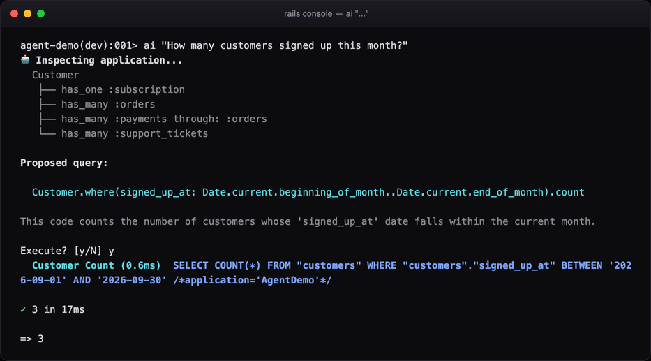
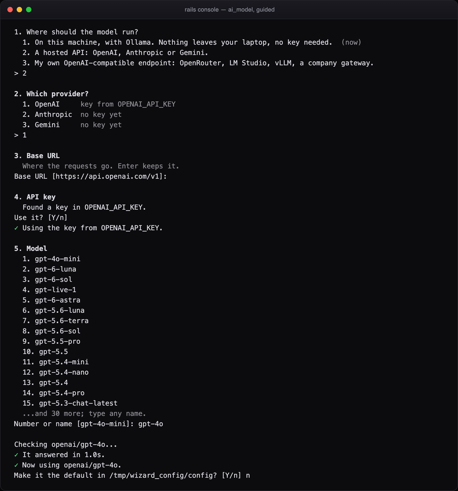
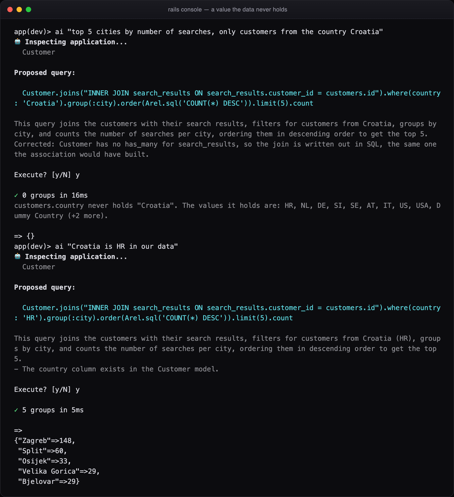
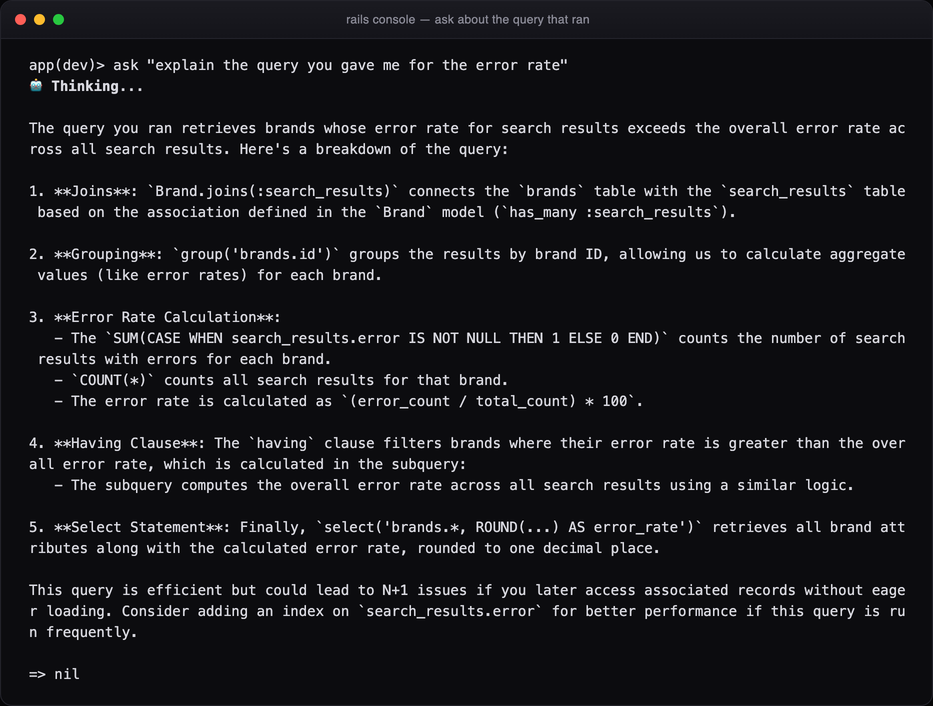
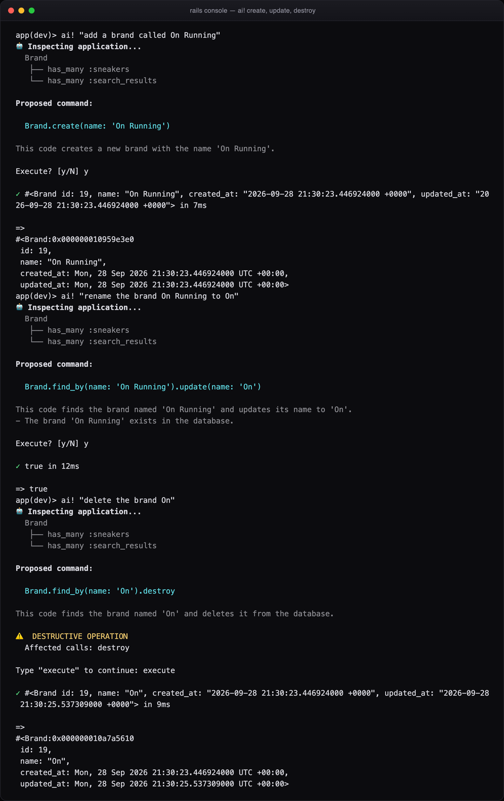
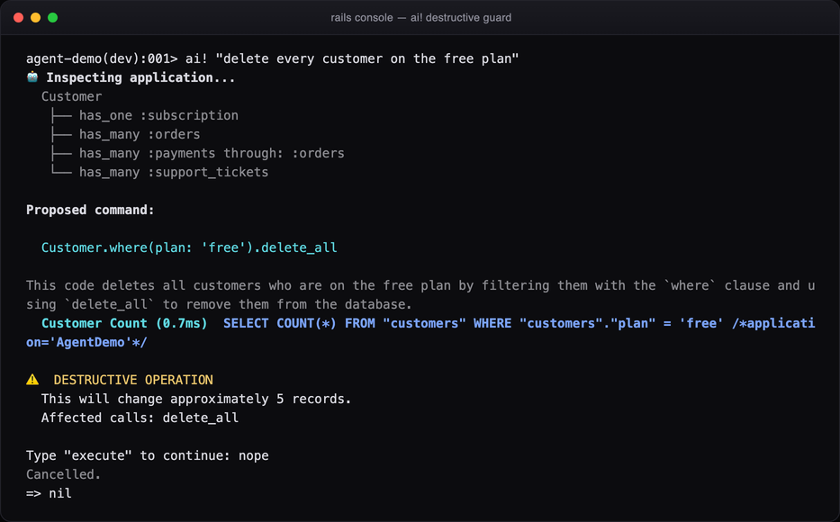
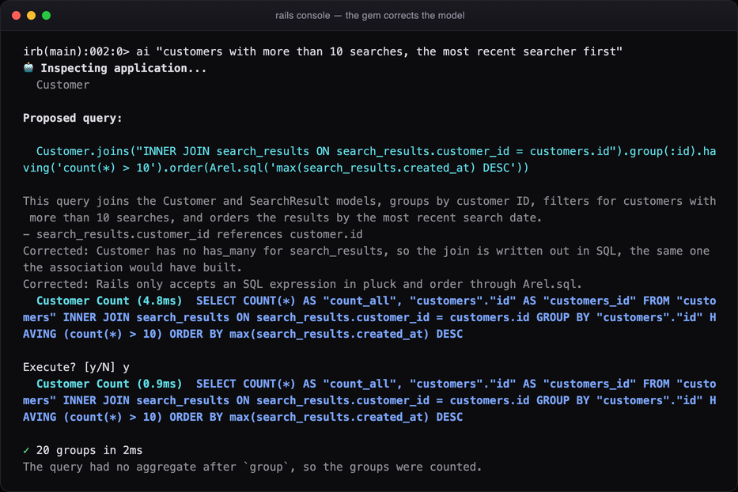

# rails_agent_console

[](https://rubygems.org/gems/rails_agent_console)
[](https://github.com/blaz1988/rails-agent-console/actions/workflows/main.yml)
[](LICENSE.txt)
[](#rails-and-ruby-support)
[](#rails-and-ruby-support)

**Plain-English questions in `rails console`, answered with ActiveRecord you read before it runs.**

`rails_agent_console` adds `ai`, `ai!`, `ask` and `explain` to the console you already use. It
describes your real schema to an LLM, gets back one ActiveRecord query, checks it call by call,
fixes the model's usual mistakes in code, and runs it only after you say yes. It's read-only by
default, costs about 1,700 tokens per question, and runs for free on a local model.

Built and maintained by [Rubycode](https://rubycode.co), a Ruby on Rails consultancy from
Zagreb. [Need Rails engineers?](#about-rubycode)



## Contents

- [Why](#why)
- [Installation](#installation)
- [Usage](#usage)
- [Choosing a model](#choosing-a-model)
- [Safety](#safety)
- [Corrections made in code](#corrections-made-in-code)
- [What the model is told](#what-the-model-is-told)
- [Configuration](#configuration)
- [Command line](#command-line)
- [Rails and Ruby support](#rails-and-ruby-support)
- [Development](#development)
- [Contributing](#contributing)
- [About Rubycode](#about-rubycode)
- [License](#license)

## Why

Counting rows, checking one record, grouping by a column: these are thirty-second questions.
Sending them through a general coding agent means it reads `schema.rb`, your models and
often more before it can write one line of ActiveRecord, and you rarely see that line.

This gem is deliberately less than an agent. It never edits files and never loops, and it
doesn't read your repository. It sends a compact description of your models, gets one query
back, and shows it to you. The result is an ordinary Ruby value in your session, so you keep
chaining on it.

Measured on a production Rails 7 app with 18 models:

| | |
| --- | --- |
| Tokens per question | about 1,700, including the schema context |
| Cost per question | about $0.0003 on gpt-4o-mini, $0 on Ollama |
| Model calls | one per question, plus a retry only when a query fails |
| Schema context vs. `schema.rb` + `app/models` | 1,214 tokens vs. 2,998 |

## Installation

Add the gem to the development group of your application's Gemfile:

```ruby
gem "rails_agent_console", group: :development
```

Then install it and open the console:

```bash
bundle install
bin/rails console
```

The first run walks you through setup: where the model runs, the provider, the base URL, the
key and the model. Every step has a suggestion, so pressing Enter all the way through works.
The model list comes from the provider itself (the installed models, for Ollama), and the
choice is checked with one short request before it's kept.



To keep settings in the application instead, generate an initializer:

```bash
bin/rails generate rails_agent_console:install
```

### API keys

Keys are looked up in this order:

1. `RailsAgentConsole.config.api_key`
2. The environment: `OPENAI_API_KEY`, `ANTHROPIC_API_KEY`, `GEMINI_API_KEY`
3. `~/.rails_agent_console/config`, mode 0600 in a 0700 directory

A key found in the environment is used as it is and never copied to disk. A key you type is
read without echo. Nothing secret is written into your application.

## Usage

| Command | What it does |
| --- | --- |
| `ai "..."` | Proposes a read-only query, shows it, runs it after confirmation |
| `ai! "..."` | Allows one write; destructive calls need a typed confirmation |
| `ask "..."` | Answers a question and never runs anything |
| `explain User.where(active: true)` | Explains an existing query or relation |
| `run "..."` | Same as `ai`; reads better for reporting questions |
| `ai_schema` | Prints exactly what the model is told about your app; pass `diagnostics: true` to show schema inspection issues |
| `ai_history` | Shows the conversation so far |
| `ai_reset` | Forgets the conversation |
| `ai_model` | Shows which model answers, and switches to another |

### Asking

```
app(dev)> ai "top 3 brands by searches in 2025, with how many different customers searched each"

Proposed query:

  SearchResult.joins(:brand).where(created_at: Time.zone.parse("2025-01-01")..Time.zone.parse("2025-12-31").end_of_day).group("brands.name").select("brands.name, COUNT(DISTINCT customer_id) AS customer_count").order(Arel.sql("COUNT(*) DESC")).limit(3)

This query retrieves the top 3 brands based on the number of searches in 2025, counting distinct customers for each brand. It filters the search results by the specified date range and groups by brand name to aggregate the customer counts.
Corrected: A range that ended on a date stopped at midnight and missed that day, so it now runs to end_of_day.

Execute? [y/N] y

✓ 3 items in 16ms
Grouped rows have no id, so each one is shown as its selected values.

=>
[{"name"=>"Nike", "customer_count"=>36},
 {"name"=>"Adidas", "customer_count"=>26},
 {"name"=>"New Balance", "customer_count"=>22}]
```

### Following up

A question that refers back (*them*, *those*, *their*, or the Croatian *ih* and *njih*) is
sent with the previous query minus its final aggregate, so its conditions carry over:

```
app(dev)> ai "How many customers signed up this month?"

  Customer.where(signed_up_at: Date.current.beginning_of_month..Date.current.end_of_month).count

=> 3

app(dev)> ai "group them by country"

  Customer.where(signed_up_at: Date.current.beginning_of_month..Date.current.end_of_month).group(:country).count

=> {"AT"=>1, "DE"=>1, "HR"=>1}
```

### When the data disagrees with the question

If a condition compares a text column with a value the column never holds, the gem says so
and lists the values it does hold. They're worked out from the column and printed in your
console only; none of them are sent to the model.



### ask

`ask` is for questions that aren't queries. When the question is about "the query you gave
me", the session's recent queries go with it, so it explains the query that actually ran.



### Writing

Writes need `ai!`. A create or an update asks for a plain yes:



## Choosing a model

| Provider | Setting | Notes |
| --- | --- | --- |
| OpenAI | `provider: :openai` | default model `gpt-4o-mini` |
| Anthropic | `provider: :anthropic` | |
| Gemini | `provider: :gemini` | |
| Ollama | `provider: :ollama` | default model `qwen2.5-coder:7b`, runs locally, no key |
| Any OpenAI-compatible endpoint | `api_base: "https://..."` | OpenRouter, LM Studio, vLLM, a company gateway |
| Anything else | `client: ->(system:, messages:) { ... }` | for example RubyLLM |

`ai_model` switches for the rest of the session and offers to make the choice the default.
The provider follows from the name:

```ruby
ai_model "gpt-4o"                    # OpenAI
ai_model "claude-sonnet-4-5"         # Anthropic
ai_model "ollama/qwen2.5-coder:7b"   # a provider and its model
```

**Free on Ollama, better on a hosted model.** With Ollama nothing leaves your laptop and there
is no bill, and a 7B model handles counting, filtering and simple grouping. For anything more
complex we recommend at least a GPT-4-class model; gpt-4o-mini is enough and costs about
$0.0003 a question. On four harder questions (a rate per brand compared with a subquery,
monthly counts with a conditional sum, a filtered top 5, and distinct counts per group),
gpt-4o-mini answered all four correctly and qwen2.5-coder:7b none. The 7B model's answers ran
without an error and looked plausible, which is the risk.

## Safety

An LLM will occasionally suggest `User.delete_all` with total confidence, so generated code is
never trusted.

- **Parsed, not pattern-matched.** Code is parsed with `Ripper` and checked call by call before
  it can run.
- **Read-only by default.** Every method has to be on an allowlist (`where`, `joins`, `group`,
  `count`, `pluck`, the ActiveSupport time helpers and so on), plus your own columns and
  associations, which come from the schema. Anything else is refused.
- **Some things are never allowed, even with `ai!`:** `connection` and `execute`, `send`,
  `eval`, `system`, backticks, `File`, `Kernel`, `ENV`, method and class definitions, instance
  and global variables, and raw SQL that modifies data or chains statements, even inside
  `Arel.sql`.
- **Credential columns are never read.** Columns named like passwords, digests, tokens,
  secrets, API keys and OTP codes are refused by name.
- **Destructive writes need a typed word.** `delete_all`, `update_all`, `destroy` and friends
  make you type a word, not press a key, and bulk ones report how many rows they would touch.
- **Isolated.** Generated code runs in a binding of its own with a timeout, so it can't read the
  console's locals, and a bad query reports itself instead of taking the console down.

```ruby
V = RailsAgentConsole::QueryValidator

V.validate("Customer.where(plan: 'free').delete_all").violations
# => ["`delete_all` writes to the database (read-only mode)"]

V.validate(%{Customer.connection.execute("DROP TABLE customers")}).violations
# => ["raw SQL that modifies data: \"DROP TABLE customers\"",
#     "`execute` is never allowed from the agent console",
#     "`connection` is never allowed from the agent console"]

V.validate("User.pluck(:email, :password_digest)").violations
# => ["`password_digest` holds a credential and is never read by the agent"]
```



The gem is meant for development and for consoles you'd trust a teammate with. Treat a
production console with the care it deserves.

## Corrections made in code

Models make the same few mistakes again and again. Rather than growing the prompt, which is
sent with every question, the gem fixes them in Ruby before anything runs, and says what it
changed:

- joins the association can't build are written out in SQL;
- association names used as table names inside SQL are replaced with the table;
- ambiguous columns in joined queries are qualified with the starting table, outside subqueries;
- a count divided by a count is divided as decimals, so a rate isn't rounded down to 0;
- `joins(search_results)` becomes `joins(:search_results)`;
- a range that ends on a plain date runs to the end of that day;
- "in 2025" and "last month" become exact ranges before the model sees the question;
- misplaced aggregates, `first` on a grouped relation, a pointless `distinct`, raw SQL in
  `order` or `pluck` without `Arel.sql`, and broken quoting.



A query that still fails is sent back with the error and a Rails-specific hint, up to
`max_repair_attempts` times (three by default). Every retry is a new proposal with the same
validation and the same confirmation.

## What the model is told

Only the shape of your application, never its data:

```
Rails 8.1.4, adapter: sqlite3

Customer (customers)
  columns: id:integer (pk), name:string (null), country:string (null), plan:string (null)
  has_one :subscription
  has_many :orders
  has_many :payments through: :orders

Invoice (invoices)
  columns: id:integer (pk), customer_id:integer, amount:decimal (null), status:string (null)
  belongs_to :customer

Other models: Order, Payment, SupportTicket
```

The models relevant to the question are described in full and the rest are listed by name,
which keeps the prompt small in applications with hundreds of models. `ai_schema "invoices"`
shows exactly what would be sent. If model or association inspection fails,
`ai_schema(diagnostics: true)` prints the skipped/partial model and the underlying error without
changing the schema context sent to the model.

## Configuration

Everything has a default. To change it, use the generated initializer:

```ruby
# config/initializers/rails_agent_console.rb
RailsAgentConsole.configure do |config|
  config.provider = :openai                  # :openai, :anthropic, :gemini, :ollama
  config.model    = "gpt-4o-mini"            # any model the provider accepts
  config.api_base = nil                      # e.g. "https://openrouter.ai/api/v1"

  config.write_mode = false                  # `ai!` is usually the better choice
  config.auto_confirm = false                # true skips the Execute? prompt
  config.extra_allowed_methods = %w[to_csv]  # widen the read-only allowlist
  config.execution_timeout = 30              # seconds, nil disables

  config.excluded_models = %w[AuditLog]      # keep models out of the prompt
  config.max_focused_models = 8
  config.extra_context = "Revenue always lives on Payment#amount_cents."

  config.max_history = 6                     # follow-up turns to remember
  config.max_repair_attempts = 3             # retries after a failed query, 0 disables
  config.console_helpers = %i[ai ai! ask explain run]
end
```

Any callable can stand in for the built-in providers, for example to run on top of
[RubyLLM](https://rubyllm.com):

```ruby
config.client = lambda do |system:, messages:|
  RubyLLM.chat.with_instructions(system).ask(messages.last[:content]).content
end
```

## Command line

```bash
bundle exec rails-agent configure   # the guided setup, outside the console
bundle exec rails-agent doctor      # the resolved configuration, and a ping to the provider
bundle exec rails-agent schema      # the schema context the model receives
```

## Rails and Ruby support

Ruby 3.1 or newer and Rails 7.0 or newer. CI runs the suite on every supported combination:

| | Rails 7.0 | Rails 7.1 | Rails 7.2 | Rails 8.0 | Rails 8.1 |
| --- | :---: | :---: | :---: | :---: | :---: |
| Ruby 3.1 | ✓ | ✓ | ✓ | | |
| Ruby 3.2 | ✓ | ✓ | ✓ | ✓ | ✓ |
| Ruby 3.3 | ✓ | ✓ | ✓ | ✓ | ✓ |
| Ruby 3.4 | | | ✓ | ✓ | ✓ |

Rails 8 needs Ruby 3.2 or newer, and Rails 7.0 and 7.1 don't load on Ruby 3.4. On Rails 8
the helpers are registered as IRB helper methods, the mechanism behind `app` and `reload!`; on
Rails 7 they're mixed into `Rails::ConsoleMethods`. Providers talk plain HTTP through
`net/http`, so the gem depends on nothing beyond Rails.

## Development

```bash
bin/setup
bundle exec rake        # specs and RuboCop
bin/matrix              # the specs on every supported Ruby and Rails combination
bin/matrix 3.3.3        # ... or on one Ruby
```

The specs run against an in-memory SQLite schema, and the provider specs against a local
socket, so nothing reaches the network. `bin/matrix` uses rbenv for the Rubies and
`gemfiles/rails_*.gemfile` for the Rails versions.

## Contributing

Contributions are very welcome, whether it's a bug report, a question the gem answered wrong, a
new provider or a fix in the rewriter. You don't need permission to start.

**Found a problem?** [Open an issue](https://github.com/blaz1988/rails-agent-console/issues/new)
with your Ruby, Rails and gem versions, the question you asked, the query the gem proposed and
what went wrong. A wrong answer from the model is a useful report too: most of them can be
fixed in code so the next person doesn't hit them.

**Want to send a fix?** Contributions go through a fork and a pull request:

1. [Fork the repository](https://github.com/blaz1988/rails-agent-console/fork) and clone your
   fork.
2. Create a branch for your change: `git checkout -b fix-date-ranges`.
3. Run `bin/setup`, make the change, and add a spec for it.
4. Run `bundle exec rake` and make sure specs and RuboCop pass.
5. Add a line to the `Unreleased` section of [CHANGELOG.md](CHANGELOG.md).
6. Push the branch to your fork and
   [open a pull request](https://github.com/blaz1988/rails-agent-console/compare) against `main`.

CI runs the specs on every supported Ruby and Rails version, and every pull request is reviewed
before it's merged. For a larger change, such as a new provider or a new console command, open
an issue first so we can agree on the approach before you write the code.

Good first contributions:

- a question that produced the wrong query, turned into a failing spec;
- a correction in the rewriter for a mistake models keep making;
- support for another LLM provider;
- clearer docs or error messages.

See [CONTRIBUTING.md](CONTRIBUTING.md) for the details. Please report security issues privately
as described in [SECURITY.md](SECURITY.md), not in a public issue.

## About Rubycode

`rails_agent_console` is written and maintained by [Rubycode](https://rubycode.co). We build
and rescue Ruby on Rails products: new applications, upgrades, performance work, and senior
Ruby and Rails engineers who join your team.

**Need Ruby or Ruby on Rails engineers? Get in touch.**

**Ivan Blažević**, creator of the gem

- Email: [ivan.blazevic@rubycode.co](mailto:ivan.blazevic@rubycode.co)
- Phone: [+385 99 351 3642](tel:+385993513642)
- LinkedIn: [linkedin.com/in/blazevic-ivan](https://www.linkedin.com/in/blazevic-ivan/)
- Web: [rubycode.co](https://rubycode.co)

## License

Released under the [MIT License](LICENSE.txt). Copyright © 2026 Ivan Blažević,
[Rubycode](https://rubycode.co).
